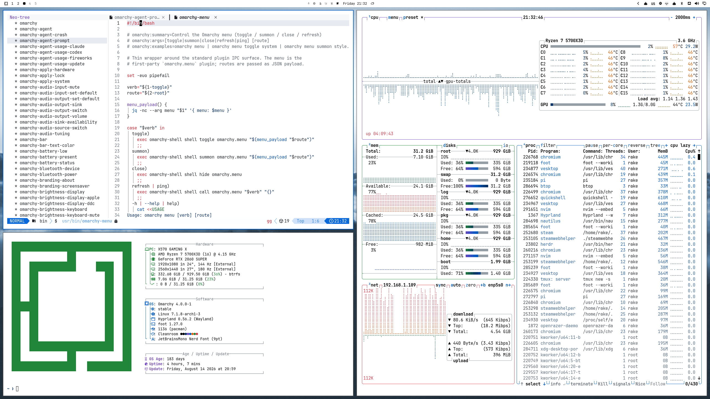

# Cleanroom

A bright, quiet Omarchy theme inspired by GitHub Light.

Cleanroom keeps the desktop deliberately spare: a white canvas, soft gray
surfaces, crisp black text, and a small set of GitHub's familiar accents. It
is built for Omarchy 4.5 and Quickshell.

## Palette

| Role           | Color     |
| -------------- | --------- |
| Canvas         | `#ffffff` |
| Surface        | `#f6f8fa` |
| Subtle surface | `#f0f0f0` |
| Text           | `#000000` |
| Muted text     | `#6a737d` |
| Accent blue    | `#005cc5` |
| Red            | `#d73a49` |
| Green          | `#22863a` |
| Orange         | `#e36209` |
| Purple         | `#6f42c1` |
| Selection      | `#fed442` |

## Install

Via the Omarchy menu: Install > Style > Theme (Super + Alt + Space) and paste
this repo URL:

https://github.com/lukasrakauskas/omarchy-cleanroom-theme

Or from the terminal:

```bash
omarchy theme install https://github.com/lukasrakauskas/omarchy-cleanroom-theme
```

The theme includes Quickshell colors, generated terminal palettes, btop,
Chromium, Firefox, VS Code, and Neovim integration.

## Neovim and Omarchy 4.5

Omarchy 4.5 generates the Neovim theme with Aether v3 from `colors.toml`.
Cleanroom tunes those palette slots for GitHub Light syntax: purple functions,
red keywords, dark-blue strings, blue numbers and constants, and gray comments.
The canvas stays white with black text. Active line numbers and matching
brackets use the blue accent instead of orange.

**Yellow selections are supported.** Visual-mode selections use `#fed442`.
Search highlighting is separate: ordinary matches have a pale purple background
(derived from the function-color slot), and the active match has a blue
background. Changing these independently needs a local Neovim highlight override.

This is a palette-based approximation, not the `github_light` colorscheme.
Aether shares some slots: legacy statements and imports use the function color,
and some built-ins and parameters share blue. Styles and plugin highlights also
differ. No extra Neovim plugin or local configuration is required.

Omarchy ignores Lua and terminal configuration files from Git-installed themes.
Cleanroom therefore lets Omarchy generate them rather than shipping an unused
`neovim.lua` or a separate Ghostty built-in theme. New terminal windows use the
same palette and yellow selections. The desktop accent, btop highlights, and
primary controls in generated Pi and Claude themes stay blue; warnings can stay
orange. The palette's slot names describe Aether inputs, not always their literal
colors. The explicit btop theme keeps its own green status colors.

After updating an existing checkout, apply it again:

```bash
omarchy theme set cleanroom
```

## Verification

On an Omarchy 4.5 installation with Neovim, Python 3.11+, and Aether v3 already
installed, run:

```bash
PYTHONDONTWRITEBYTECODE=1 python -m unittest discover -s tests -v
```

The tests generate configs in a temporary home directory, load Aether in isolated
headless Neovim, and check the actual syntax, controls, and selection highlights.
They also check terminal and app configs. Nothing is downloaded or applied to the
live desktop. Set `AETHER_PATH` if the installed plugin is not at
`~/.local/share/nvim/lazy/aether`.

## Screenshot



## Credits

- **GitHub Light palette:** adapted from [GitHub Light Theme by Zhu Yun-ling](https://github.com/yunlingz/vscode-theme-github-light), also published as [`Hyzeta.vscode-theme-github-light`](https://marketplace.visualstudio.com/items?itemName=Hyzeta.vscode-theme-github-light).
- **Neovim syntax reference:** [projekt0n/github-nvim-theme](https://github.com/projekt0n/github-nvim-theme), by **projekt0n**.
- **Generated Neovim theme:** [omacom/aether.nvim](https://github.com/omacom/aether.nvim), via Omarchy's Aether v3 integration.

## License

Cleanroom is distributed under the included [MIT License](LICENSE). The
credited upstream projects retain their own licenses; please see their
repositories for the full notices.

Cleanroom is an independent Omarchy theme and is not affiliated with GitHub.
